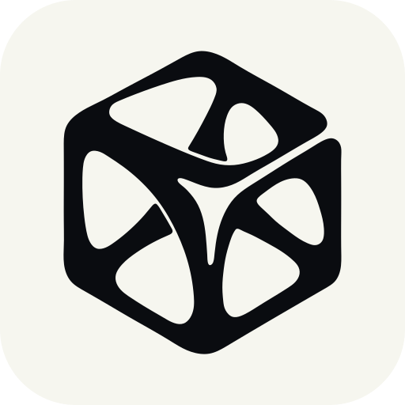
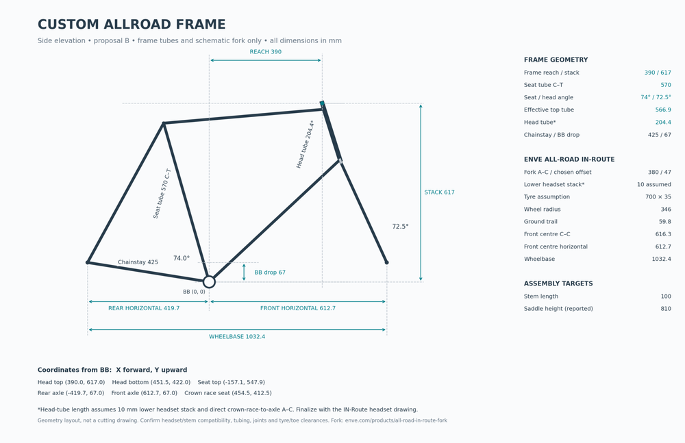
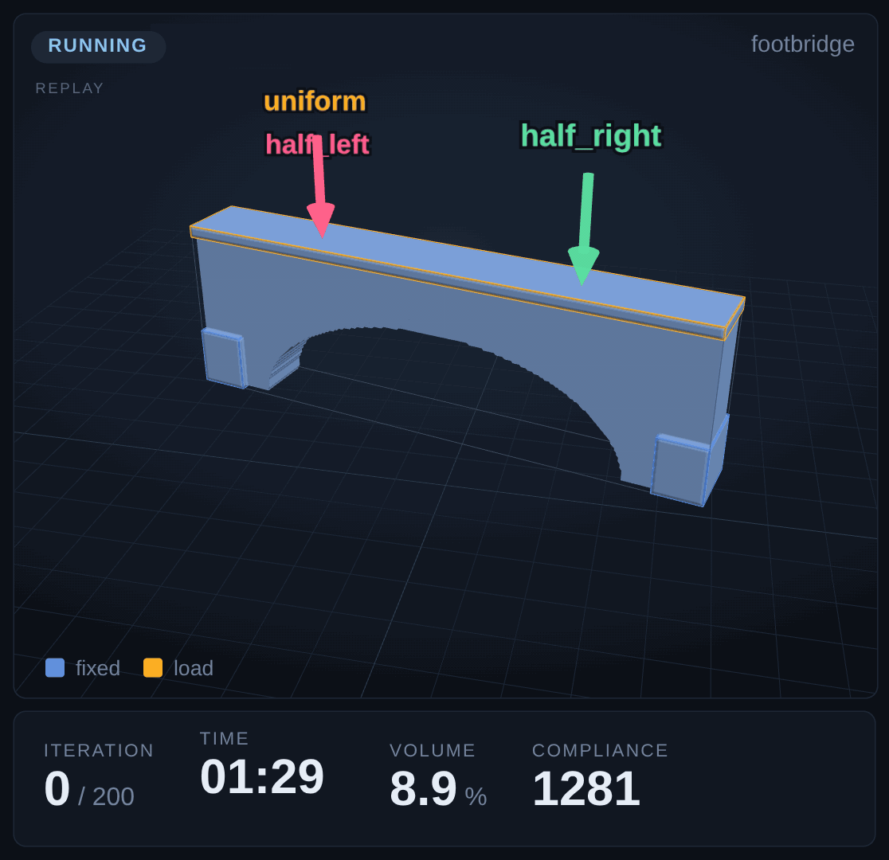
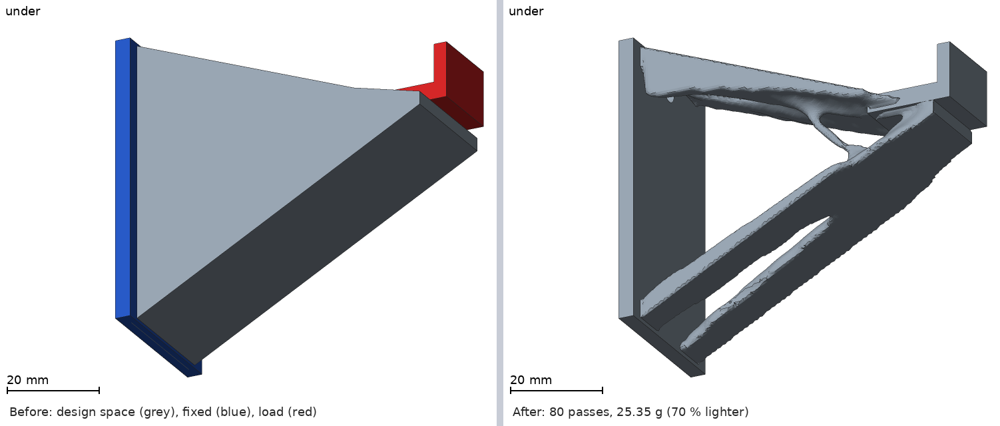

#  topopt

[](LICENSE)


[Install](#install) | [Use](#use) | [Examples](examples/README.md) | [Documentation](#documentation) | [License](#license)

<h3>topopt is an MCP server for topology optimization that works with Claude, Codex, Cursor and other AI agents.</h3>

It gives your AI agent a topology optimizer that sets itself up and runs on your own computer. The start part can be an STL file you already have, a sketch, a description in words, or a shape you work out with the agent in the chat: the rough form, where it is mounted and where the loads go, checked in a picture and changed until it is right. Then **topopt** runs the topology optimization: it finds a light shape that carries those loads and writes a smooth STL file that you can print.

More on the website: [topopt.ai](https://topopt.ai)

Three ways to start a part:

- **An STL file that you have.** "Here is `bracket.stl`. Keep the two screw holes, the tip carries 5 kg. Make it lighter."
- **A sketch and a few words.** "I'm building a bike frame with 3D-printed lugs. Can the head tube lug be topology optimized?"
  With a sketch like this one:

  <a href="https://topopt.ai/assets/early-frame-sketch.png"></a>
- **Words only.** "A wall hook for a T-shirt, two screws, 2 kg." Or a footbridge on two supports, or a stool that holds 100 kg.



*A footbridge on two supports: a recorded run (200 passes, 39 minutes with `gpu-mg` on an integrated GPU) in the dashboard replay.*

## Install

**topopt** works with any agent client that supports MCP servers. We test it most with Claude and recommend it, but **topopt** is not tied to Claude.
**topopt** runs on a Mac with Apple silicon or on Linux x86_64, with at least 16 GB of memory for the example.
You need no tool first: **topopt** uses your uv if you have one (uv 0.6.8 or newer); else the setup downloads a pinned uv release and checks its checksum.

### What the setup downloads, and what topopt sends

<details>
<summary>About 200 MB, once. <b>topopt</b> sends no data unless you allow diagnostic data.</summary>

- **uv 0.13.5**, only if **topopt** finds no uv that it can use (18 MB, checked by its SHA256). **Python 3.13** through uv (35 MB), the **55 packages** of `requirements.lock` from PyPI, and **setuptools** (the setup builds the **topopt** code with it): about 200 MB in all, about 700 MB on disk. The sizes are from Linux x86_64.
- After a plugin update, a complete setup links the code again offline. It downloads only when the lock file changed, and once when the Python of the launcher changes (the update to Python 3.13 downloads Python 3.13 and the packages again, about 180 MB, and needs the network).
- **topopt sends no data unless you allow it to send diagnostic data.** A run, the dashboard server (`127.0.0.1` only), the tools and the pages that open in your browser connect to nothing outside your computer, and they work offline.
- The details, and how we checked them: [What the setup downloads](docs/reference/install.md#what-the-setup-downloads-and-what-topopt-sends).
</details>

### Clients

<details>
<summary><b>Claude Desktop</b></summary>

Claude Desktop is the most tested client and the one we recommend: the chat shows the pictures that **topopt** makes of your part.

1. Download [topopt.mcpb](https://github.com/chartergroup/topopt/releases/latest/download/topopt.mcpb) from the newest release (v0.5.1).
2. Open the file with Claude Desktop.
3. In a new chat, ask for the first example: "Run the topopt example examples/hook/hook.yaml and give me the dashboard link."

The first start sets up Python in the background: 1 to 3 minutes. Until then, the chat marks a **topopt** call as Failed: that is the setup status, not a fault.
Everything else (the skills for the chat, the work folder field, problems): [Claude Desktop](docs/reference/install.md#claude-desktop).

The Code tab of Claude Desktop uses the Claude Code plugin: see Claude Code below.

</details>

<a id="quick-start-claude-code-plugin"></a>
<details>
<summary><b>Claude Code</b></summary>

This repo is a Claude Code plugin and also its marketplace. `#latest` is the newest release. In a terminal:

```
claude plugin marketplace add chartergroup/topopt#latest
claude plugin install topopt@topopt
```

Or in a Claude Code session:

```
/plugin marketplace add chartergroup/topopt#latest
/plugin install topopt@topopt
```

Then start Claude Code in your work folder and type:

```
/topopt:start-here
```

Claude checks the machine, helps you describe the part, checks the problem, starts the run and gives you the dashboard link (usually `http://127.0.0.1:8765/`).
The first start sets up Python for the plugin: 1 to 3 minutes, about 200 MB ([what it downloads](#what-the-setup-downloads-and-what-topopt-sends)). Until then, a **topopt** tool answers with the setup status.

In the Code tab of Claude Desktop, the plugin command opens Settings > Plugins. Add the plugin there:

1. Open Settings > Plugins. Press + Add, choose Add marketplace, then Add from a repository.
2. Type `chartergroup/topopt#latest` in the field URL and press Sync.
3. Right after the sync, press Add on **topopt: topology optimization for 3D printing**. In the dialog about local MCP servers, press Continue.
4. Start a session in a project folder and ask for the first example.

More: [The Code tab: the plugin](docs/reference/install.md#the-code-tab-the-plugin).

To update an install from `#latest`, run these in a terminal, then start a new session:

```
claude plugin marketplace update topopt
claude plugin update topopt@topopt
```

A pinned install updates another way: [Update](docs/reference/install.md#update).
Pinned releases, a checkout and first-run problems: [Install the Claude Code plugin](docs/reference/install.md#install-the-claude-code-plugin).

</details>

<details>
<summary><b>Generic MCP client</b></summary>

Every client starts the same server. Get a checkout and set it up once:

```
git clone https://github.com/chartergroup/topopt
cd topopt
sh scripts/topopt-env.sh sync
```

Then add the server to the MCP config of your client, with full paths (VS Code names the top key `servers`; Gemini CLI has no key `type`):

```json
{
  "mcpServers": {
    "topopt-local": {
      "type": "stdio",
      "command": "sh",
      "args": ["/full/path/to/topopt/scripts/topopt-env.sh", "mcp"],
      "env": { "TOPOPT_WORKSPACE": "/full/path/to/topopt" }
    }
  }
}
```

If the tools do not show, run this in the checkout (about 2.5 s on Linux x86_64; it prints progress lines):

```
sh scripts/topopt-env.sh doctor
```

The setup, a JSON and a TOML config template, and the typical problems: [the guide for any MCP client](docs/reference/any-mcp-client.md).

</details>

### Other clients

For each client below, set up a checkout as in "Generic MCP client". [The client facts](docs/clients.md) have the dates.

<details>
<summary><b>Cursor</b></summary>

Open the `topopt` folder in Cursor and enable the **topopt** MCP server of `.cursor/mcp.json`.
In the one Mac test (2026-10-27) this server stayed Disabled, and a user entry in `~/.cursor/mcp.json` worked ([the entry](docs/clients.md#cursor)).

</details>

<details>
<summary><b>Codex CLI</b></summary>

Start `codex` in the `topopt` folder and trust the project when Codex asks. The project file `.codex/config.toml` starts the server.
More: [Codex CLI](docs/clients.md#codex-cli).

</details>

<details>
<summary><b>VS Code</b> (agent mode)</summary>

Put this in `.vscode/mcp.json` of the `topopt` folder, open the folder in VS Code and trust the workspace:

```json
{
  "servers": {
    "topopt": {
      "type": "stdio",
      "command": "sh",
      "args": ["${workspaceFolder}/scripts/topopt-env.sh", "mcp"],
      "env": { "TOPOPT_WORKSPACE": "${workspaceFolder}" }
    }
  }
}
```

More: [VS Code agent mode](docs/clients.md#vs-code-agent-mode-github-copilot).

</details>

<details>
<summary><b>Gemini CLI</b></summary>

Put this in `.gemini/settings.json` of the `topopt` folder, start `gemini` there and trust the folder:

```json
{
  "mcpServers": {
    "topopt": { "command": "sh", "args": ["scripts/topopt-env.sh", "mcp"] }
  }
}
```

More: [Gemini CLI](docs/clients.md#gemini-cli).

</details>

## Use

With an agent client, ask in words. You can:

- **Bring or describe the part.** One YAML file and one STL file for each region; the agent can write them from your words
  ([The YAML format](docs/reference/problem-and-run.md#the-yaml-format)).
- **Check it.** `topopt check` gives the grid size and a time estimate, and starts no run ([Run a problem](docs/reference/problem-and-run.md)).
- **Run it and watch.** The dashboard shows the shape, the volume and the compliance while the run goes
  ([The dashboard](docs/reference/dashboard-mcp-render.md)). A recorded run plays again with `--replay`
  ([Replay](docs/reference/dashboard-mcp-render.md#replay-a-recorded-run)).
- **Run a fine pass.** A finer voxel from the design of a finished run ([Fine pass](docs/reference/fine-pass.md)).
- **Check the print and the stress.** [Print checks](docs/reference/print-step-tet.md) and [Verify the result](docs/reference/verify.md).
- **Get the STL and the numbers.** `result/final.stl` and `result/metrics.json`: mass, stiffness and run time
  ([The final mesh](docs/reference/problem-and-run.md#the-final-mesh)).
- **Get pictures.** [Render](docs/reference/dashboard-mcp-render.md).

In a client that shows MCP Apps, for example Claude Desktop, ask the agent to show the part in 3D: the chat shows the design space, the regions,
an arrow for each load and the time estimate (the tool `show_problem`, see [MCP server and its tools](topopt_mcp/README.md#tools)).
The button "Start the run" in that view starts the run; the view then shows the pass and the volume every 5 seconds, and at the end
a button "Discuss the result" gives the chat a message about the result (the host may put it into the chat input for you to send).



The hook: a full block of the design space would weigh 85.6 g. The part weighs 25.4 g (70 % less). The run took 133 s with `gpu-mg` on an integrated GPU.

**Examples.** [The gallery](examples/README.md) shows each example part with a picture, the run and the mass. To run one, ask your agent,
or in a checkout after [Install](docs/reference/install.md#install): `topopt run examples/hook/hook.yaml --out runs/hook`.

**Change a part with words.** [The hook prompt guide](examples/hook/PROMPTS.md) shows four prompts that change the hook example: two hooks at an angle
on one base, three screws, a 2 kg jacket in place of a T-shirt, and a lighter part. Each prompt has its picture, the mass and the files to run it again.

**The work folder** is where **topopt** keeps your runs (`runs/<name>/`). How to change it for each client: [The work folder](docs/reference/install.md#the-work-folder).

## Documentation

- The reference pages:
  - [Install, platforms and your machine](docs/reference/install.md)
  - [Run a problem](docs/reference/problem-and-run.md)
  - [The dashboard, the MCP server and the render](docs/reference/dashboard-mcp-render.md)
  - [Print checks, the STEP file and the tet mesher](docs/reference/print-step-tet.md)
  - [Verify the result, ratchet and cleanup](docs/reference/verify.md)
  - [Run topopt in any MCP client](docs/reference/any-mcp-client.md)
  - [Fine pass](docs/reference/fine-pass.md)
  - [Tests, acceptance and limits](docs/reference/tests-and-limits.md)
- [Client facts](docs/clients.md), with dates.
- [CONTRACTS.md](CONTRACTS.md): the final spec: the YAML schema, the CLI, the snapshot format.
- [MCP server and its tools](topopt_mcp/README.md).
- [The example gallery](examples/README.md) and [the hook example](examples/hook/README.md).
- [How the pictures of this page were made](docs/media/README.md), and [the recorded hook run](recordings/README.md) for a replay of the dashboard.
- [Releases](RELEASING.md) and [the changelog](CHANGELOG.md).
- [Test an install in a client](docs/install-test-checklist.md) and report back.

## License

**topopt** is under the MIT license: see [LICENSE](LICENSE). [Third-party notices](THIRD_PARTY_NOTICES.md) list the license of every package
that **topopt** installs and of the third-party files in this repository.

## Contributing

We recommend contributing with a coding agent. The instructions for agents are already in this repository, so open the folder in your agent
and it finds what it needs by itself.

To contribute by hand, or to see the whole process (an issue first, a branch, a review by someone else, a person merges), read
[the contributing guide](CONTRIBUTING.md).
