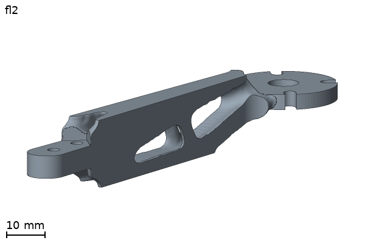
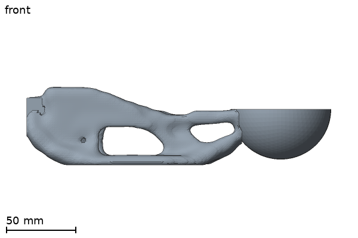
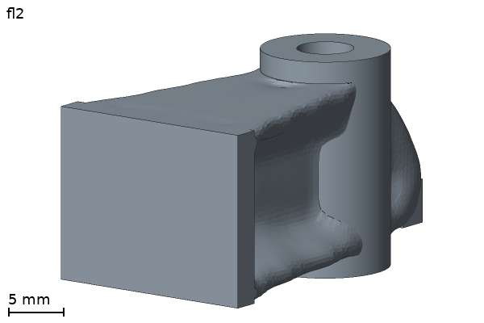
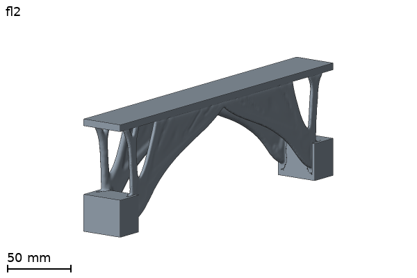

# Examples

An example is a part that you can run again: a problem YAML, its STL region files and a README. Each tile shows the finished part of one run.
Back to the [main README](../README.md).

| Example | Part | Run | Mass before, after | Picture |
|---|---|---|---|---|
| [hook](hook/README.md) | A T-shirt wall hook with two screw holes. | 133.3 s (80 passes 89.8 s, then the post step), `gpu-mg`, 1.2 mm voxels, 80 passes | 85.6 g, 25.4 g (70.4 % less) |  |
| [drone_arm](drone_arm/README.md) | One arm of a 5-inch quadcopter frame, with clamp bolts and a motor pad. | 969.8 s (200 passes 773.4 s, then the post step), `gpu-mg`, 0.5 mm voxels, 200 passes | 24.7 g, 10.8 g: the mass of the plain 6 mm plate arm, so the result is 1.9 to 7.8 x stiffer, not lighter (see its README) |  |
| [ladle](ladle/README.md) | A gravy ladle: a grip, a carved handle and a bowl. | 49.3 s (80 passes 39.4 s, then the post step), `gpu-mg`, 3.25 mm voxels, 80 passes | 1,555.5 g, 236.9 g (84.8 % less) |  |
| [interfaces](interfaces/README.md) | A bracket with a bore, a boss and a machined face. | 13.5 s (40 passes 7.6 s, then the post step), `gpu-mg`, 1.0 mm voxels, 40 passes | 15.3 g, 6.7 g (56.3 % less) |  |
| [footbridge](footbridge/README.md) | A footbridge deck on two supports. | 2,314.9 s (200 passes 2,239.3 s, then the post step), `gpu-mg`, 1.1 mm voxels, 200 passes | 650.9 g, 186.1 g (71.4 % less) |  |

Change the hook with words: [four prompts and their results](hook/PROMPTS.md).

"Before" is the mass of the full design space: every active voxel solid, with the fixed, load and solid regions (`topopt check` prints it as the full block;
`mass_design_space_g` of `result/metrics.json`). "After" is `mass_final_g` of the same file, the mass of `final.stl`.
The run time is `run_time_s` of `metrics.json`; the time of the passes is `elapsed_s` of the last line of `history.jsonl`.
The numbers are one run each, not a promise for your machine. The README of an example says where its run was made, where that is known.
The drone arm is designed at the mass of a plain 6 mm plate arm (`target_mass_g`), so it is not a mass saving against that arm: its README gives the stiffness ratios.

Other files here: `custom_constraint.py` and `motion_rows.py` are scripts, not parts.

## How the pictures are made

Every picture is `topopt render` of the `result/final.stl` of the run, with the part only (`--regions off`), at 600 x 400 pixels. The views are the
project views of [docs/media/README.md](../docs/media/README.md): `fl2` (from the front left, a little above) for the hook, the arm and the bracket,
and `front` for the ladle (`front` shows the two openings of the handle in profile). Run the commands in the repo folder; `<run>` is the folder of the run.

```
topopt run examples/hook/hook.yaml --out runs/hook
topopt run examples/drone_arm/drone_arm.yaml --out runs/drone_arm
topopt run examples/ladle/ladle.yaml --out runs/ladle
topopt run examples/interfaces/bracket.yaml --out runs/interfaces

topopt render <run>/result/final.stl --role part --regions off --size 600x400 --views "fl2:-1.333,-1,0.373" --out <out>   # hook, drone_arm, interfaces
topopt render runs/ladle/result/final.stl --role part --regions off --size 600x400 --views "front:0,-1,0" --out <out>      # ladle
```

The render writes `final_<view>.png` and a montage; copy `final_<view>.png` to `examples/<name>/result.png`.

The runs of the tiles:

- hook: `examples/hook/hook.yaml` as it is, with `settings.solver: auto`, which picked `gpu-mg` (the integrated GPU of an Intel Core Ultra 9 185H host),
  2026-10-28, on main 3585ef6. The same run makes the strip of the main README ([docs/media/README.md](../docs/media/README.md)).
- drone_arm: the run of `examples/drone_arm/drone_arm.yaml` as it is (0.5 mm, 200 passes, `gpu-mg`), 2026-10-27. Its time and memory are in the README of the example.
- ladle and interfaces: `examples/ladle/ladle.yaml` and `examples/interfaces/bracket.yaml` as they are, with `settings.solver: auto`, which picked `gpu-mg`
  (the integrated GPU of an Intel Core Ultra 9 185H host), 2026-10-28, on main 5f2a523.
  For the bracket the picture is `final.stl`, the as-printed part with stock to machine, not `nominal.stl`.
- footbridge: the region files and settings of `examples/footbridge/footbridge.yaml` (1.1 mm, 200 passes, `settings.solver: auto`, which picked `gpu-mg`),
  2026-10-28, on main 5f2a523. The run stopped at its pass limit.
