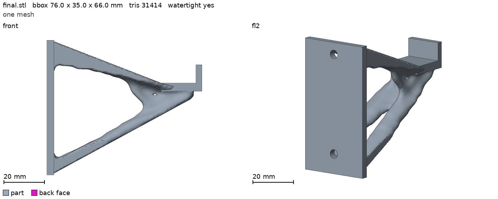
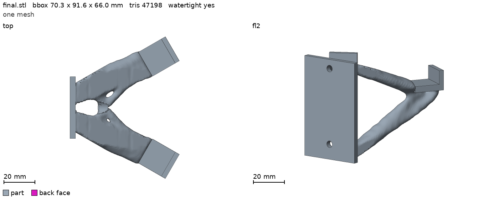
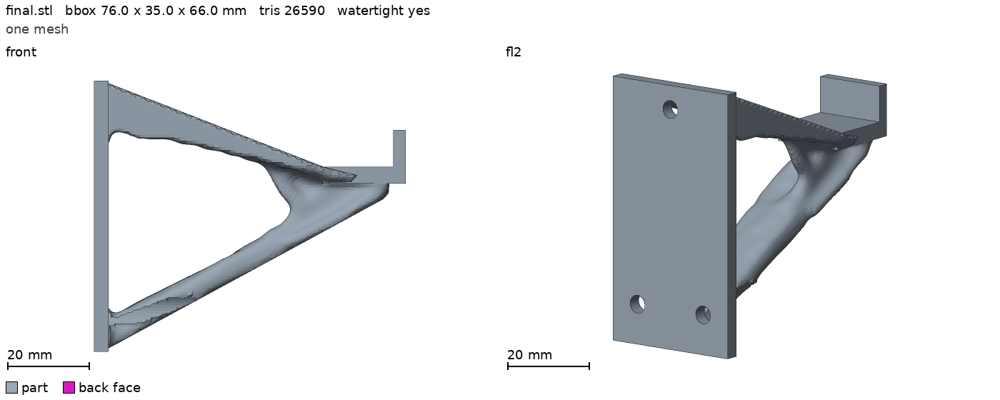
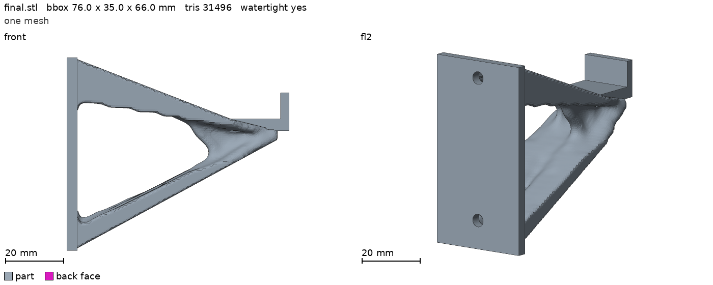
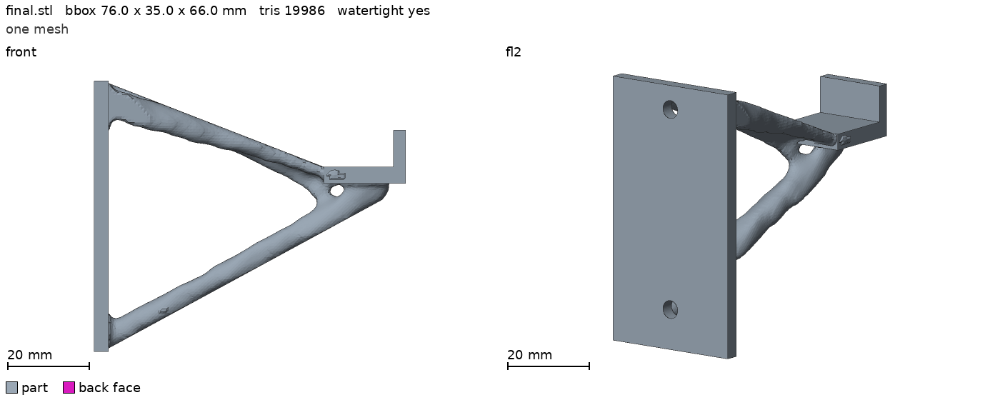

# Change the hook with words

topopt does not only optimize a finished part. You can tell an agent how the part must change, and it writes a new problem YAML and new region STL files from your words.
This guide starts from the [T-shirt hook](README.md) and gives four prompts. Each one changes the hook in one way.

The agent follows the skill `part-to-topopt` ([.claude/skills/part-to-topopt/SKILL.md](../../.claude/skills/part-to-topopt/SKILL.md)):
it turns the words into a spec (`spec.yaml`), builds the region STL files and the problem YAML with `build_regions`, checks them with `topopt check`, and runs.
Each folder in [prompts/](prompts/) has the files of one prompt, so you can run it again:

```
topopt check examples/hook/prompts/two_hooks/problem.yaml
topopt run examples/hook/prompts/two_hooks/problem.yaml --out runs/two_hooks
```

All five runs (the plain hook and the four prompts) use the same settings: 1.5 mm voxels, 80 passes, PLA, `settings.solver: auto`.
`auto` picked `gpu-mg` on an integrated GPU (the machine of the example runs). The numbers are one run each, on main 3585ef6.
The mass is `mass_final_g` of `result/metrics.json` (the mass of `final.stl`). The run time is the `done in` time of the run.
`hook.yaml` uses 1.2 mm voxels; 1.5 mm is faster and shows each change. The log of each run says that the 3.5 mm wall plate needs a voxel of
1.25 mm or less (a fine pass), so run a prompt at 1.2 mm before you print the part.
The pictures are `topopt render` of `final.stl` with the part only, from the views of [docs/media/README.md](../../docs/media/README.md): `front` and `fl2`, and `top` for the two hooks.

## The plain hook (for comparison)

The files are in [prompts/plain/](prompts/plain/): the spec of the skill (`examples/hook_spec.yaml`) with a 1.5 mm voxel.



Mass 28.0 g (the full design space is 87.3 g). Run time 87.3 s, `gpu-mg`, 1.5 mm voxels, 80 passes.

## Prompt 1: two hooks at an angle

> Make two hooks at an angle from one shared base, so that two T-shirts hang.

What the agent changed: a second saddle and lip, each turned 30 degrees to one side (a V in the plan view), on one plate that is 40 mm wide instead of 35 mm.
There is one load region for each tip, a shirt of 1.96 N on each, and one abuse pull of 30 N for each arm (two cases). The design space is the hook space, 110 mm wide, cut to two strips and the root.
The screws are as before. [prompts/two_hooks/](prompts/two_hooks/) has the files.



Mass 41.9 g (the full design space is 143.7 g). Run time 89.2 s, `gpu-mg`, 1.5 mm voxels, 80 passes.
The angle (30 degrees), the 40 mm plate and the shirt mass are assumptions of the agent. They are in the `assumptions` list of the spec, and a user can change them.

## Prompt 2: three screws

> Mount it with three screws: one at the top and two at the bottom.

What the agent changed: the bottom screw hole is now two holes at 10 mm to each side of the middle. Each has the 4.5 mm shaft and the 9 mm channel for the head and the screwdriver.
Nothing else changed. [prompts/three_screws/](prompts/three_screws/) has the files.



Mass 27.7 g (28.0 g for the plain hook). Run time 137.2 s, `gpu-mg`, 1.5 mm voxels, 80 passes.
The three holes show in the picture. The lower strut is wider at the plate, with small notches where the two channels pass, because the channels cut the design space.

## Prompt 3: one more property, a heavier load

> It must hold a 2 kg jacket, not a T-shirt.

What the agent changed: the load. The static force is 2 kg x 9.81 = 19.6 N (ten times the shirt). The abuse pull is 5 times that, 98.1 N, in the direction of the plain hook.
The weight of the static case is 25, by the rule of the plain hook (the square of the force ratio). The agent also raised the volume fraction from 0.2 to 0.3, as the skill says for a big abuse load.
[prompts/heavier_load/](prompts/heavier_load/) has the files.



Mass 35.6 g (28.0 g for the plain hook). Run time 75.7 s, `gpu-mg`, 1.5 mm voxels, 80 passes.
The jacket mass is the user's word. The skill tells the agent to ask for a load that the user did not give; here the user gave it. The 5 times pull is the choice of the agent, and the spec says so.

## Prompt 4: make it lighter

> Make it lighter: about 18 g.

What the agent changed: `settings.target_mass_g: 18` in place of `volume_fraction: 0.2`. The loads and all regions are as in the plain hook.
The builder turns the target into a volume fraction of 0.093. [prompts/lighter/](prompts/lighter/) has the files.



Mass 19.9 g (28.0 g for the plain hook). Run time 59.4 s, `gpu-mg`, 1.5 mm voxels, 80 passes.
The target mass is the mass before smoothing, as `topopt check` prints it. The mass of `final.stl` is 1.9 g higher: the plain hook is also 1.8 g above its target (26.2 g).
A lighter part is also less stiff: `compliance_final` in `result/metrics.json` is 2.94 here and 1.26 for the plain hook (the same loads). Look at it before you print the part.
