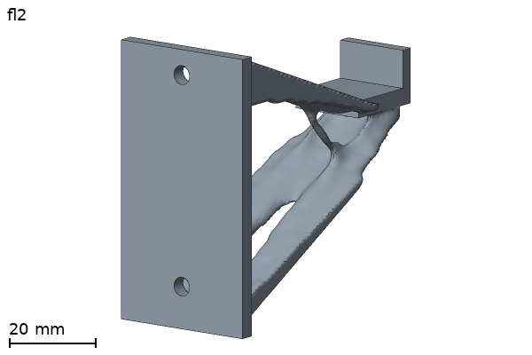

# T-shirt wall hook (demo object)

The picture is the `final.stl` of a run of `hook.yaml` as it is (80 passes, 133.3 s, `gpu-mg` on an integrated GPU, 2026-10-28). All examples: [examples/README.md](../README.md).

Change the hook with words (two hooks, three screws, a heavier load, a lighter part): [PROMPTS.md](PROMPTS.md).

Make the files: `.venv/bin/python examples/hook/make_hook.py`
(add `--no-table` to skip the voxel count table). The script is safe to run
many times. It checks that each STL is closed and prints the bounds and volumes.

Run the optimizer: `topopt run examples/hook/hook.yaml --out runs/hook`

`hook_short.yaml` is the CI case: the same hook with 2.0 mm voxels and 40 iterations (about 20 s at 1 thread).
CI runs it and compares the result with `ci/golden/hook_short.json` (CONTRACTS.md section 27). It is not a design to print.

`hook_gpu_fallback.yaml` is a short hook run that forces the GPU solver to fail (a `gpu_tol` and a `gpu_backward_error` that no device reaches), so that
you can see the fallback of `settings.solver: auto` on a machine with a GPU: the run goes on with the CPU solver and ends with the exit code 0 (CONTRACTS.md section 20).
It is a check of the tool, not a design to print.

`hook_mirror.yaml` is the same hook with a `mirror` key (a plane at y = 0 mm). The design is then symmetric about that plane
(CONTRACTS.md section 26.1). `topopt check examples/hook/hook_mirror.yaml` prints the parity, the orphans and the load asymmetry.

## Coordinates (mm)

The wall is the plane x = 0. The hook goes out in +x. z is up. y is sideways.

| Region | File | Role | Box (x / y / z) |
|---|---|---|---|
| Wall plate | `wall_plate.stl` | fixed | 0..3.5 / -17.5..17.5 / -30..30 |
| Screw holes (2) | `screw_hole_top.stl`, `screw_hole_bottom.stl` | keep_out | at y = 0, z = +30 and -20 |
| Tip | `hook_tip.stl` | load `tip` | 56..76 / -9..9 / 11..24 |
| Design space | `design.stl` | design | 2..72 / -14..14 / -30..30 |

- The plate is 3.5 mm thick, 35 mm wide and 66 mm tall (z = -30..36).
- Each hole has a 4.5 mm shaft through the plate. It also has a 9 mm channel
  in front of the plate, through the full part depth (to x = 80), for the
  screw head and the screwdriver. The optimizer cannot fill this space.
- The top screw is at z = 30, above the lip (lip top z = 24). At z = 20 the
  lip and the top member blocked the screwdriver path (fixed 2026-10-08).
- The tip is a flat saddle (20 x 18 x 4 mm) with a lip at the end. The lip is
  3 mm thick and 9 mm higher than the saddle. It stops the shirt from slipping off.
  The saddle and the lip are one closed body.
- The design space is a prism. Its side view is a five-corner shape. It is
  66 mm tall at the wall (z = -30..36). It narrows to the saddle at x = 56..72. The top edge
  slopes down, so the collar can reach the saddle top. Nothing is above the saddle.

## Load cases

| Case | Force (N) | Weight |
|---|---|---|
| `hang` | [0, 0, -1.96] | 234 |
| `pull_off` | [20.89, 5.21, -20.89] | 1 |

- `hang`: a shirt of about 200 g. 0.2 kg x 9.81 m/s2 = 1.96 N, straight down.
- `pull_off`: a fast yank of 30 N. The direction is 45 degrees out of the wall
  and down in the x-z plane, with a 10 degree turn to the side (y). So
  F = 30 x [cos45 cos10, sin10, -sin45 cos10]. A hard pull on a shirt by one
  hand is about 20 to 40 N, so 30 N is a middle value. The outward part
  (20.9 N) pulls the plate off the wall. The side part makes the shape 3D.

Why the weights differ: compliance scales with F squared. The force ratio is
30 / 1.96 = 15.3, so the compliance ratio is about 234. With equal weights the
hang case would be 0.4 percent of the objective, and the optimizer would
ignore it. The weight 234 = (30 / 1.96)^2 makes both cases give about the
same force-squared share of the objective. The two cases have different
stiffness per newton, so the real shares can differ. After the first real run,
look at `compliance_cases` in `history.jsonl` and change the weight if one
case is far larger than the other.

## Settings

- `volume_fraction`: 0.2 of the design volume.
- `iterations`: 80.
- `voxel_size`: 1.2 mm (see "Voxel size decision" below). This gives 39,944 active voxels (`topopt check` prints the count; the table
  below has other voxel sizes).
- Other settings use the defaults of CONTRACTS.md.
- Material: PLA defaults (E 3500 MPa, nu 0.35, 1.24 g/cm3).
- Solid design space: 65.9 cm3 (the volume of `design.stl`; `make_hook.py` prints it) x 1.24 g/cm3 = 82 g.
  `topopt check` counts every active voxel as solid and prints 85.6 g. The volume fraction 0.2 applies to the free design
  voxels. For the whole hook (design part, plate and tip) `topopt check` prints the target 21,718 mm3 = 26.9 g before smoothing.
  `metrics.json` has the real values (the run of the picture: `mass_final_g` 25.35).

## Active voxel counts

Active = design + fixed + load voxels (labels 1, 2, 3). I counted with a
voxel-centre inside test (`trimesh contains`). The voxelizer must give
the same numbers within about 1 percent. The grid is the bounding box of all
STLs, snapped outward.

| voxel size (mm) | grid voxels | design | fixed | load | active |
|---|---|---|---|---|---|
| 0.80 | 324,368 | 109,126 | 12,832 | 3,718 | 125,676 |
| 1.00 | 166,320 | 57,888 | 6,024 | 1,926 | 65,838 |
| 1.25 | 83,328 | 28,482 | 3,960 | 966 | 33,408 |
| 1.50 | 49,920 | 16,456 | 1,896 | 648 | 19,000 |

To change the voxel size, edit `voxel_size` in `hook.yaml`. Rough rule: the
active count scales with 1 / h^3. At 1.0 mm the thinnest part (the plate) is
3 voxels thick. At 1.5 mm it is 2 voxels thick, which is too coarse for the lip.

## Print notes

- Option 1: plate flat on the bed. The footprint is 35 x 66 mm and the hook
  grows up 76 mm. Layers then run parallel to the wall, so a hard pull can
  split the layers. This is the weak option.
- Option 2: lie the part on its side (y down). The footprint is 76 x 66 mm and
  the layers follow the arm. This is better for strength, but it needs support
  material under the arm. Both options fit a 220 x 220 mm bed.

## Voxel size decision (orchestrator, 2026-10-08)

The hook uses `voxel_size: 1.2`. At 1.0 mm one iteration takes 4.7 s, and the
run does not fit 4:00. At 1.2 mm one iteration takes 1.3 s. See CONTRACTS.md
section 11.

## Stress example (A2): `hook_stress.yaml`

The same hook as a stress-limited mass minimization: `settings.objective: mass`, one stress limit for each load case
(`hang`: `stress_limit` 1.5 MPa; `pull_off`: `stress_limit` 0.5 MPa, with `allowable_mpa` 40, the material value that the report uses for the
achieved safety factor). The 40 MPa is an example value that the file gives with its source. The tool has no default allowable (decision D7): the allowable is your choice. The filament catalog (CONTRACTS.md section 18.8) holds data-sheet numbers with a source, not an allowable.
CONTRACTS.md section 17 has the keys and the report.

- The row is a target that the optimizer tries to meet. The run log and `result/metrics.json` (`stress.cases.<case>.relaxed.met`,
  `stress.stage_ends`) say whether it was met.
- The limit of `pull_off` is 0.5 MPa because at 2.4 mm the limit sets the member size. With 5 MPa (the first form of this example) the force
  of 30 N needs about 6 mm2, one voxel face; the optimizer made members one voxel thick, the relaxed rows were met, and `final.stl` was the wall
  plate alone (15 g, no tip). With 1 MPa `final.stl` was one body, but a thin neck joined the tip to the plate (`topopt verify`: 1 N/mm).
  With 0.5 MPa `final.stl` is one body and `topopt verify` gives 667 N/mm. The limits 0.7, 1.5 and 2 MPa, a larger `filter_radius` and a
  compliance objective were measured as well. After a run, read
  `stress.load_paths` in `metrics.json`: it says whether the thresholded part and `final.stl` join each load region to a fixed region, and the
  summary of the case says when they do not. A joined region does not say how stiff the joint is: `topopt verify` does.
- The example uses 2.4 mm voxels, 220 iterations and `move_limit: 0.03` (the upper limit of the trial step of the step acceptance).
  It is not the talk run.
- Measured result (2.4 mm, CLI, Linux x86_64, PARDISO, shared machine with a load of 7 on 22 cores):

  | Threads | `final.stl` | Final mass (STL) | End g `pull_off` / `hang` | Rejected tries | Run time | Peak RSS |
  |---|---|---|---|---|---|---|
  | 1 | 1 body, tip joined to the plate | 37.81 g | +0.0000 / -0.967 | 38 in 33 of 220 passes | 63 s | 779 MiB |
  | 4 | 1 body, tip joined to the plate | 37.27 g | +0.0006 / -0.968 | 63 in 48 of 220 passes | 56 s | 800 MiB |

  The row is met when `g <= 5e-3`. Both runs meet both rows at the end and at the end of each of the four beta stages. The `hang` row is not
  active (the limit 1.5 MPa is far above its relaxed peak 0.05 MPa); `pull_off` sets the part. `topopt verify` on the two runs (4 s, 0.54 GB):
  one body, stiffness 667 and 685 N/mm for `pull_off`, p99.9 1.52 and 1.44 MPa. Without the step acceptance (`stress_step_acceptance: false`)
  the 5 MPa form of the example ended with `pull_off` g between +0.006 and +0.094, and the row swung around the limit during the run
  (reviewer's runs).
- The physical voxel peak of `pull_off` is 0.61 to 0.65 MPa (grey design) and 0.51 to 0.52 MPa (thresholded design) for the limit 0.5 MPa,
  from about 1290 design voxels (31 to 36 voxels above the limit in the grey design). The relaxed peak is 0.48 to 0.49 MPa. The two numbers
  are not the same measure, and the relaxed number is not the stress of the printed part. At 2.4 mm the members are about 2.8 voxels thick at the high-stress voxels (p10), so
  the report gives the numbers as estimates with the error range of p99.9 (-59 % to +57 %: the union of the bench and 5 public parts; the lower end, -58.32 %, is this hook at 2.4 mm, `pull_off`, run type MS, in `bench/stress_public_parts.json`), and no pass or fail. That range is the largest error measured: the P2 p99.9 of `pull_off`
  (`topopt verify`) was 2.3 to 2.4 times the voxel p99.9 in four run types (`bench/stress_public_parts.json`). For the stress of the part, run `topopt verify`. The run log and
  `stress.cases.<case>.summary` give the range in one text, for example (1 thread, `pull_off`): "the optimizer row is met for the relaxed
  stress (relaxed peak 0.48 MPa, limit 0.5 MPa, g +0.0000). Voxel estimate of the part stress, peak: 0.517 to 0.646 MPa (thresholded design
  0.517, grey design 0.646); limit 0.5 MPa. Both voxel estimates are above the limit (the limit is 0.77 times the grey peak; 31 of 1285
  voxels are above 0.5 MPa in the grey design). "Met" is about the relaxed measure, not about the part."
- The `topopt check` estimate for the example is about 32 s (with the stress rows 4 s of it), and the range line says 32 to 51 s. The
  runs took 56 and 63 s. The time model has no fixed cost for each pass, so it under-estimates a small problem.
- At 1.2 mm (the voxel size of `hook.yaml`), measured with the step acceptance (the 5 MPa form of the example; its `final.stl` has 2 bodies,
  the plate and the tip, and no material between them): the example YAML with `voxel_size: 1.2`,
  `iterations: 160`, `beta_schedule: [[0, 1], [40, 2], [80, 4], [120, 8]]` and `stress_limit: 5.0` for `pull_off`
  (CLI, 4 threads, PARDISO, shared machine, load 2.6 to 16, one run). It took 845 s (median pass 4.9 s, 2.0 GB of memory
  for the whole run) and ended with both rows met: `hang` g +0.0007, `pull_off` g +0.0005, final mass 14.7 g, relaxed peak of
  `pull_off` 4.46 MPa. The `pull_off` g at the four stage ends was +0.0041, +0.0008, -0.0000 and +0.0005. The row goes up at
  each stage start (g +1.5 at the start, then +0.4, +3.9 and +1.3 in the first passes of the next stage, when the sharper projection
  thins the members) and the step acceptance brings it back inside the stage. 94 tries were rejected in 87 of the 160 passes.
  Without the step acceptance the same kind of run from a uniform start collapsed (volume 3 % to 8 %, stress 10 to 100 times the limit).
  The voxel peak of `pull_off` is 6.04 MPa (1366 design voxels). p99.9 rests on the top 1 to 4 voxels: it is the voxel at rank 2 from the top, 5.97 MPa).
  This is one run on one machine: the end state changes a little with the thread count.

## Buckling example (A6b): `hook_buckling.yaml`

The same hook with `buckling: {min_factor: 150}` (CONTRACTS.md section 39, a working number). The row holds the lowest linear buckling factor of each load case
at or above 150. The numbers below are one run (E3 of the A6b step 2): commit 13d55da, Linux x86_64, Intel Core Ultra 9 185H (22 threads), 98 GB RAM, PARDISO, 4 threads, a shared
host (load average 4 at the start, 8 to 13 during the run).

| | `hook.yaml` (no row) | `hook_buckling.yaml` |
|---|---|---|
| Run time (81 passes, 0 to 80) | 170 s (median pass 1.7 s) | 1469 s (median pass 17.2 s) |
| Peak memory (VmHWM) | 1.8 GB | 2.0 GB |
| Lowest factor, `pull_off`, gray design (the row) | 113.7 | 173.5 |
| Lowest factor, `pull_off`, printed design (the A6a check) | 120.9 | 190.8 |
| Lowest factor, `hang`, printed design (the A6a check) | 1276 | 1549 |
| Final compliance | 1.3891 | 1.3887 |

- `pull_off` starts at a factor of 32 (g +3.66), reaches 150 at pass 6, and holds 150.8 to 160.4 from pass 6 to pass 64 (160.4 at pass 50). At the beta 8 stage (pass 65) the factor rises to 181 and falls to 173.5. The row ran at all 81 passes
  for this case (the last factor stayed within 1.5 times `min_factor`). `hang` stays far above (443 at pass 0, 1460 at the end) and the skip rule ran it at 18 of 81 passes.
- The data of every pass (time, evaluated flag, reason, lowest factor, g, row seconds, solves, and the time of the run without the row) is in `docs/a6b-e3-passes.csv`.
- 99 evaluations in all (`pull_off` 81, `hang` 18), none failed (`n_fail` 0). The adjoint residual was at most 4.6e-13. The evaluation of one case took a median of 9.3 s (`hang`, 51 solves) and 12.2 s (`pull_off`, 66 solves);
  the first two passes took 26 to 31 s (110 to 193 solves). The row is 85 percent of the run time.
- The factor is a voxel estimate on the gray design, and a tet model gave 0.71 to 0.79 times the voxel factor on the hook (CONTRACTS.md section 39). The mass is the same (25.2 g): the volume row holds it.
